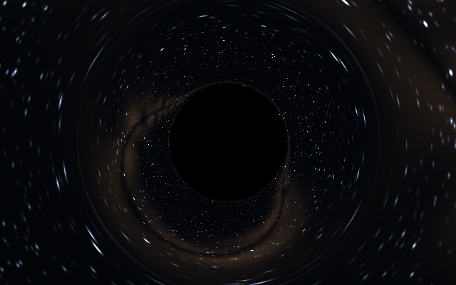

# Buraco Negro de Schwarzschild — Ray Tracing Relativístico

> **🚧 WIP — Work in Progress**

Simulação numérica da propagação da luz nas proximidades de um buraco negro de Schwarzschild utilizando geodésicas da Relatividade Geral.

O projeto já implementa um **ray tracer relativístico** que produz a sombra aparente e a lente gravitacional de um buraco negro sobre um céu procedural, a partir da integração de geodésicas nulas.



Imagem gerada por `python main.py`, em 640 × 400 pixels, com câmera a 30M.
O fundo é procedural; a imagem ainda não inclui disco de acreção.

---

## Instalação e execução

Execute os comandos na raiz do repositório (`/workspace/BlackHole` no cloud).
Em uma máquina nova, instalar as dependências é pré-requisito:

```bash
python -m pip install -r requirements.txt
```

O ambiente cloud já tem as dependências instaladas. O único entrypoint é:

```bash
python main.py
```

Quando a `.venv` local existe, `python main.py` usa automaticamente o
interpretador desse ambiente, sem exigir ativação manual.

O comando `python main.py` executa as sete validações físicas, imprime o
resumo e, se todas passarem, executa o ray tracing em **640 × 400 pixels**,
com campo de visão vertical de **45°** e câmera a **30M**. Com display,
exibe a imagem; sem display, salva automaticamente em `outputs/blackhole.png`.
O diagrama geométrico anterior continua disponível com `--mode geometry`.

Flags implementadas para esse mesmo entrypoint:

| Flag | Comportamento |
| --- | --- |
| `--headless` | Executar sem janela e salvar a imagem após as validações. |
| `--output CAMINHO` | Definir o caminho do arquivo de imagem. |
| `--validate-only` | Executar somente as validações físicas, sem renderizar. |
| `--mode raytrace\|geometry` | Selecionar ray tracing (padrão) ou diagrama geométrico 2D. |
| `--width N` | Largura em pixels do ray tracing (padrão: 640). |
| `--height N` | Altura em pixels do ray tracing (padrão: 400). |
| `--fov GRAUS` | Campo de visão vertical do ray tracing (padrão: 45). |
| `--distance D` | Distância da câmera em unidades de M (padrão: 30). |

Essas opções mantêm `python main.py` como único entrypoint.

Para executar os 16 testes automatizados com `unittest`, na raiz do
repositório:

```bash
.venv/bin/python -m unittest discover -s tests -v
```

As dependências externas revisadas nos imports são NumPy, SciPy, SymPy e
Matplotlib, todas declaradas em `requirements.txt`. A pasta `.venv/`, os
caches Python, o cache simbólico de Christoffel e `outputs/` são ignorados
pelo Git.

---

## Sobre o projeto

Este projeto implementa um modelo numérico de um **buraco negro de Schwarzschild**, considerando:

* buraco negro não rotativo;
* carga elétrica nula;
* espaço-tempo isolado;
* Relatividade Geral;
* unidades geométricas $G=c=M=1$.

A base física do projeto é a **métrica de Schwarzschild** e a equação das **geodésicas**.

Para um raio de luz, a trajetória é obtida pela integração numérica de

$$\frac{d^2x^\mu}{d\lambda^2} + \Gamma^\mu_{\alpha\beta} \frac{dx^\alpha}{d\lambda} \frac{dx^\beta}{d\lambda} =0$$

sujeita à condição de geodésica nula

$$g_{\mu\nu} \frac{dx^\mu}{d\lambda} \frac{dx^\nu}{d\lambda}=0.$$

A ideia central é lançar raios a partir de uma **câmera virtual**, integrar suas trajetórias para trás através do espaço-tempo e determinar o que cada pixel da imagem observaria.

---

## Estado atual

### Modelo físico

* [x] Métrica de Schwarzschild
* [x] Símbolos de Christoffel
* [x] Equações das geodésicas
* [x] Integração numérica
* [x] Horizonte de eventos
* [x] Esfera de fótons
* [x] Órbitas circulares
* [x] ISCO
* [x] Limite de espaço plano
* [x] Limite newtoniano
* [x] Validação da precessão do periélio

### Visualização

O modo padrão integra um raio por pixel e forma a imagem com a sombra e
o céu procedural desviado pela gravidade. O modo `--mode geometry` conserva
o diagrama de horizonte ($2M$), esfera de fótons ($3M$), ISCO ($6M$), eixos
e grade. Nesse modo há suporte para desenhar trajetórias, mas sua conexão
com a saída da simulação no `main.py` ainda está pendente.

* [x] Renderer 2D
* [x] Horizonte de eventos
* [x] Esfera de fótons
* [x] ISCO
* [x] Suporte a desenho de trajetórias das geodésicas no renderer
* [ ] Conexão das trajetórias ao renderer pelo entrypoint
* [x] Câmera estática em referencial ortonormal local
* [x] Geração de raios por pixel
* [x] Ray tracing relativístico
* [x] Sombra do buraco negro por captura numérica
* [x] Lente gravitacional do fundo
* [x] Campo de estrelas procedural
* [ ] Disco de acreção
* [ ] Redshift gravitacional
* [ ] Efeito Doppler relativístico

---

# Modelo físico

A métrica de Schwarzschild é dada por

$$ds^2 = -\left(1-\frac{2M}{r}\right)c^2dt^2 + \left(1-\frac{2M}{r}\right)^{-1}dr^2 + r^2d\theta^2 + r^2\sin^2\theta\,d\phi^2.$$

Neste projeto são utilizadas unidades geométricas:

$$G=c=M=1.$$

Assim,

$$ds^2 = -\left(1-\frac{2}{r}\right)dt^2 + \left(1-\frac{2}{r}\right)^{-1}dr^2 + r^2d\theta^2 + r^2\sin^2\theta\,d\phi^2.$$

As principais escalas características do sistema são:

| Estrutura | Raio |
| --- | --- |
| Horizonte de eventos | $2M$ |
| Esfera de fótons | $3M$ |
| ISCO | $6M$ |

---

## Geodésicas

O estado utilizado na integração é

$$\mathbf{y} = (t,r,\theta,\phi, \dot{t},\dot{r},\dot{\theta},\dot{\phi}).$$

A dinâmica é escrita como

$$\dot{x}^{\mu}=u^\mu$$

e

$$\dot{u}^{\mu} = -\Gamma^\mu_{\alpha\beta} u^\alpha u^\beta.$$

Para fótons, a trajetória deve satisfazer

$$g_{\mu\nu}u^\mu u^\nu=0.$$

Dessa forma, a propagação da luz é determinada pela geometria do espaço-tempo, e não por uma aproximação newtoniana.

---

# Validação física

Antes de utilizar o modelo para produzir imagens, suas propriedades físicas são verificadas numericamente.

Resultados atuais:

```text
[Teste 1] Espaço plano (M->0): dr aprox. constante = True
[Teste 2] Limite newtoniano: erro relativo = 0.0004, ok = True
[Teste 3] Captura no horizonte: motivo=capture, r_final=2.0020, ok=True
[Teste 4] Esfera de fótons: desvio máx. de 3M = 0.0000, ok=True
[Teste 5a] Órbita circular estável em r=10.0M: desvio máx.=0.0000, ok=True
[Teste 5b] ISCO em r=6M: desvio máx.=0.0000, ok=True
[Teste 6] Precessão: numérico=0.356577, esperado=0.329867, erro rel.=0.0810, ok=True

=== Resumo ===
flat_space: OK
newtonian_limit: OK
event_horizon: OK
photon_sphere: OK
circular_orbit: OK
isco: OK
precession: OK

```

A validação é importante porque o objetivo do projeto é gerar a imagem a partir da dinâmica relativística, e não simplesmente desenhar um buraco negro visualmente convincente.

A suíte automatizada atual tem **16 testes**. Esses testes são distintos
das sete validações executadas pelo entrypoint e cobrem condições iniciais
nulas da câmera, espaço plano, acordo com o integrador completo de
Christoffel, captura/escape em torno de $b_{\mathrm{crit}}$, sombra para um
observador a distância finita, deflexão fraca $4M/b$, convergência por
refinamento do passo e da fronteira externa, comportamento perto da
separatriz, escala de massa/comprimento e regressões do entrypoint.

---

# Ray Tracing

A implementação atual usa **backward ray tracing**.

Em vez de emitir milhões de fótons a partir do buraco negro, cada pixel da câmera gera um raio que é propagado **para trás** através do espaço-tempo.

```text
                 CÂMERA

        ┌───────────────────────┐
        │ • • • • • • • • • • │
        │ • • • • • • • • • • │
        │ • • • • • • • • • • │
        └───────────────────────┘
             \   |   |   /
              \  |   |  /
               \ |   | /
                \|   |/
                 \   /
                  \ /
                  (●)
             BURACO NEGRO

```

Para cada pixel:

1. determinar a posição da câmera;
2. determinar a direção do raio;
3. construir as condições iniciais do fóton;
4. garantir a condição nula $ds^2=0$;
5. integrar a geodésica;
6. verificar se o raio é capturado ou escapa;
7. determinar a origem aparente do raio;
8. atribuir uma cor ao pixel.

O resultado é uma imagem construída diretamente a partir das trajetórias dos fótons.

### Câmera e integração

A câmera pinhole estática fica em $+x$, aponta para a origem e usa $+y$
como direita e $+z$ como cima. Cada centro de pixel define uma direção
unitária no referencial ortonormal local do observador. Para frequência
local unitária, a conversão para velocidades afins usa
$r'=\sqrt{1-2M/d}\,n_r$ e mantém as componentes transversais locais,
garantindo condições iniciais nulas. A câmera deve ficar fora do horizonte.

Pela simetria esférica, cada geodésica está em um plano orbital. Definindo
$r=|\mathbf{x}|$ e $L=|\mathbf{x}\times\mathbf{x}'|$, a redução espacial
**exata** das geodésicas nulas de Schwarzschild é

$$\mathbf{x}''=-\frac{3ML^2}{r^5}\mathbf{x}.$$

As derivadas são em relação ao parâmetro afim. Essa equação equivale a
$r''=L^2/r^3-3ML^2/r^4$ e $\phi'=L/r^2$; não é uma aproximação
newtoniana. O tempo coordenado é dispensável para este fundo estático.

O integrador usa **RK4 vetorizado**, com passos afins escalados por
$r/|\mathbf{x}'|$. Perto do parâmetro de impacto crítico, quando
$|b/b_{\mathrm{crit}}-1|<10^{-4}$, usa **DOP853 de alta precisão**
(`rtol=2e-13`, `atol=2e-14`). Aqui $b=L/E$ e
$E^2=|\mathbf{x}'|^2-2ML^2/r^3$. O parâmetro de impacto seleciona o
método numérico; **não define uma máscara analítica de sombra**.

A captura depende da trajetória integrada atingir $r\leq2.002M$; o escape
exige cruzar para fora a esfera de raio $\max(200M,4d)$. Raios que esgotam
o orçamento de integração permanecem não resolvidos. Também são mantidos
não resolvidos os raios com $|b/b_{\mathrm{crit}}-1|<10^{-12}$, onde a
classificação na separatriz não é confiável em precisão finita. O renderer
interrompe com erro se houver raios não resolvidos, sem tratá-los como captura.

### Aproximações e limites atuais

A direção de escape é avaliada em uma fronteira finita e aproxima a direção
assintótica do céu; aumentar o raio de escape permite verificar esse erro.
A captura em $2.002M$ também é um limiar numérico externo ao horizonte.
Há um raio por centro de pixel, **sem antialiasing**, e resolução espacial,
passo e orçamento de integração limitam os detalhes próximos da sombra.
O modelo não inclui rotação do buraco negro, disco de acreção, efeito
Doppler nem redshift gravitacional na cor/intensidade da imagem.

---

# Sombra do buraco negro

A **sombra aparente** já emerge dos raios capturados, que recebem cor preta.

O raio crítico da órbita de fótons para um observador distante está relacionado ao parâmetro de impacto crítico:

$$b_{\mathrm{crit}} = 3\sqrt{3}\,M.$$

Para a câmera estática a distância finita $d$ usada nos testes ($d>3M$),
o raio angular da sombra satisfaz

$$\sin\alpha=\frac{3\sqrt{3}M}{d}\sqrt{1-\frac{2M}{d}}.$$

Esse valor é uma referência de validação da sombra integrada, não uma
regra para pintar os pixels.

Isso é importante porque a sombra observada não corresponde simplesmente ao círculo físico do horizonte

$$r=2M.$$

A curvatura do espaço-tempo faz com que fótons que passam fora do horizonte também possam ser capturados.

A fronteira da sombra emerge naturalmente da classificação entre:

```text
                 FÓTONS QUE ESCAPAM
                        ↑
                 \      |      /
                  \     |     /
                   \    |    /
                    \   |   /
                     \  |  /
                      \ | /
                       \|/
                      ( ● )
                       /|\
                      / | \
                     /  |  \
                    /   |   \
                 FÓTONS CAPTURADOS

```

---

# Lente gravitacional

Os raios que passam próximos à esfera de fótons sofrem grandes desvios angulares.

O ray tracer já calcula o desvio gravitacional do céu, incluindo trajetórias
fortemente defletidas perto da esfera de fótons. A deflexão no campo fraco
é testada contra $4M/b$. Estudos específicos de múltiplas imagens e anéis
de Einstein em configurações controladas continuam como extensões futuras:

* múltiplas imagens;
* anéis de Einstein em configurações apropriadas.

---

# Campo de estrelas

O fundo atual é um **céu procedural determinístico**, com estrelas e uma
faixa difusa com estrutura e poeira. Não usa um catálogo astronômico e
essa faixa não é um disco de acreção.

Sem o buraco negro:

```text
★       ★           ★

    ★          ★

          ★

 ★              ★

```

Com o buraco negro, as direções dos raios que escapam amostram esse céu
após o desvio pela geometria do espaço-tempo.

Assim, a distorção do campo visual é consequência direta do ray tracing.

---

# Disco de acreção

O **disco de acreção ainda não está implementado** e permanece no roadmap.

Nesse estágio, cada raio poderá:

1. ser lançado pela câmera;
2. atravessar o espaço-tempo;
3. interceptar o disco;
4. determinar a posição do ponto emissor;
5. calcular a contribuição de luz observada.

Posteriormente poderão ser incluídos efeitos relativísticos como:

* redshift gravitacional;
* blueshift gravitacional;
* efeito Doppler;
* velocidade orbital do material;
* variação da intensidade observada.

---

# Arquitetura

O projeto separa o modelo físico da visualização.

A árvore abaixo descreve os módulos atuais. `physics/` e `simulation/`
mantêm o integrador geral com Christoffel; `raytracing/` implementa a câmera,
a redução espacial exata das geodésicas nulas e a formação da imagem.
`renderer/` conserva o diagrama geométrico opcional.

```text
BlackHole/
│
├── physics/
│   ├── metric.py
│   ├── christoffel.py
│   ├── geodesic.py
│   ├── constants.py
│   └── initial_conditions.py
│
├── simulation/
│   ├── integrator.py
│   ├── events.py
│   └── trajectories.py
│
├── validation/
│   ├── newtonian_limit.py
│   ├── photon_sphere.py
│   ├── schwarzschild_radius.py
│   ├── circular_orbits.py
│   └── precession.py
│
├── renderer/
│   ├── renderer_2d.py
│   ├── geometry.py
│   ├── styles.py
│   └── camera.py
│
├── raytracing/
│   ├── __init__.py
│   ├── camera.py
│   ├── integrator.py
│   ├── background.py
│   └── renderer.py
│
├── tests/
│   ├── test_main.py
│   └── test_raytracing.py
│
└── main.py

```

A arquitetura segue o fluxo:

```text
       MODELO FÍSICO
             │
             ▼
     INTEGRAÇÃO NUMÉRICA
             │
             ▼
         GEODÉSICA
             │
             ▼
        RAY TRACING
             │
             ▼
           PIXEL
             │
             ▼
          IMAGEM

```

No modo padrão, `main.py` valida a física e chama `raytracing.renderer`:
a câmera gera os raios, o integrador classifica as trajetórias e o renderer
amostra o céu para os escapes, atribuindo preto às capturas. A física da
propagação fica no integrador; o fundo procedural é independente dela.

---

# Tecnologias

* **Python**
* **NumPy**
* **SciPy**
* **SymPy**
* **Matplotlib**

O objetivo é implementar o modelo diretamente a partir das equações físicas, evitando depender de um motor pronto de simulação ou renderização de buracos negros.

---

# Roadmap

```text
[x] Métrica de Schwarzschild
[x] Símbolos de Christoffel
[x] Equações das geodésicas
[x] Integração numérica
[x] Validação física
[x] Renderer 2D
[x] Suporte ao desenho das geodésicas no renderer
[ ] Conexão das geodésicas ao renderer pelo main.py
[x] Salvamento automático de imagem sem display
[x] Flags --headless, --output CAMINHO e --validate-only
[x] Modo padrão raytrace e modo opcional geometry
[x] Opções --width, --height, --fov e --distance

[x] Câmera estática em referencial ortonormal local
[x] Geração dos raios
[x] Ray tracing de geodésicas nulas
[x] RK4 vetorizado e DOP853 perto do parâmetro crítico
[x] Classificação numérica captura/escape e estado não resolvido
[x] Sombra do buraco negro
[x] Lente gravitacional do fundo
[x] Campo de estrelas procedural
[ ] Disco de acreção
[ ] Redshift gravitacional
[ ] Efeito Doppler relativístico
[ ] Rotação do buraco negro
[ ] Antialiasing
[ ] Renderização em alta resolução
[ ] Otimizações adicionais de performance

```

---

# Status

**🚧 WIP — Work in Progress**

O modelo relativístico e a bateria principal de validações físicas já estão implementados.

O **ray tracing pixel a pixel já é o modo padrão** do entrypoint, com sombra
e lente gravitacional sobre um céu procedural. O diagrama geométrico segue
disponível em `--mode geometry`. A suíte automatizada atual registra 16
testes aprovados, além das sete validações físicas do entrypoint.

A imagem atual resulta da propagação dos fótons pelo espaço-tempo curvo
de Schwarzschild, com as aproximações numéricas descritas acima. Disco de
acreção, antialiasing e efeitos relativísticos de emissão continuam pendentes.
